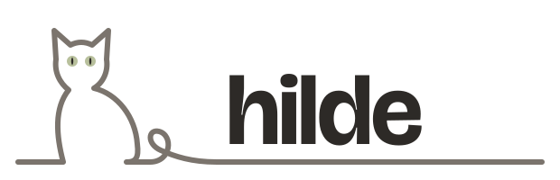

<picture>
  <source media="(prefers-color-scheme: dark)" srcset="docs/logo/hilde-wordmark-dark.svg">
  
</picture>

Hilde programming language: High-Integrity, Linear, Deterministic, Explicit

Website: https://hilde-lang.org/

# Hilde

A small, strict systems language that compiles to C. The form comes
from Ada, the safety from Rust with a simpler rule, the size from Go.
Hilde is a fork of Austral by Fernando Borretti.

Hilde is an experiment with one aim: to make coding with AI assistants
safer. The mistakes an AI typically makes are the ones a strict compiler
can catch, and in Hilde each of them is a compile error with a clear
message, so the assistant sees its mistake and fixes it.

## Features

- **Linear types**: a value that holds a resource must be used exactly
  once; using it twice or forgetting it is a compile error
- **No garbage collector**, nothing happens silently
- **Contracts**: pre- and postconditions on functions
- **Concurrency** that is easy to write: tasks and channels
- **Standard library**: regular expressions, maps, SQLite and SQLCipher,
  TLS, HTTP, JSON, arrays, SVG charts
- **Libraries**: build a static or shared C library or a WebAssembly module
- **Packages**: `hilde get`, `update`, `verify`, `install`
- **Platforms**: Linux, OpenBSD, FreeBSD, macOS; Android and iOS as libraries

## A first programme

```
module body Example.HelloWorld is
    function main(): ExitCode is
        printLn("Hello, world!");
        return ExitSuccess();
    end;
end module body.
```

A linear value, used once:

```
record Ticket: Linear is
    seat: Nat32;
end;

function use(ticket: Ticket): Nat32 is
    let { seat: Nat32 } := ticket;
    return seat;
end;
```

More in [examples/](examples) and [docs/learning-hilde.md](docs/learning-hilde.md).

## Quick start

```sh
make
make test
cd examples/hello-world && make && ./main
```

On OpenBSD and FreeBSD use `gmake`. Requirements per system:
[docs/building.md](docs/building.md).

## Commands

| Command          | Purpose                                                    |
|------------------|------------------------------------------------------------|
| `hilde compile`  | Compile modules to a programme, a C library or WebAssembly (`build` is the same) |
| `hilde check`    | Parse and type-check a module in a second                  |
| `hilde test`     | Run `*.test.hiq` tests; `--memory`, `--race`, `--valgrind` |
| `hilde fmt`      | Format files or directories                                |
| `hilde query`    | Ask the compiler about the functions of modules            |
| `hilde guard`    | Show what a programme does in C                            |
| `hilde modules`  | List every module with its files and exports               |
| `hilde lsp`      | Language server for editors                                |
| `hilde run`      | Start a job on several hosts (SPERLI)                      |
| `hilde get`, `update`, `verify`, `export`, `new`, `install`, `doc` | Packages |

## Testing

- `make test`: unit tests of the compiler
- `python3 test-programs/runner.py`: end-to-end tests
- `bash run-examples.sh`: the examples
- `./hilde test standard/src lib/builtin`: the standard library

## Serving the web

A Hilde programme that serves the web speaks FastCGI on a Unix socket
behind [Hiawatha](https://hiawatha.leisink.net/), our preferred web
server. [docs/hiawatha.md](docs/hiawatha.md) lists the settings.

## Built with Hilde

| Project | What |
|---------|------|
| [Wolly](https://github.com/heikozim/hilde-wolly) | a web framework: Web-ready, OpenBSD-first, Linear, Lean, Yours |
| [RAMBO](https://github.com/heikozim/hilde-rambo) | Rights, Accounts, Multi-factor, Bearer tokens & OAuth: an OpenID provider with passkeys |
| [MIRCO](https://github.com/heikozim/hilde-mirco) | a science kit: Matrices, Interpolation, Random numbers, Calculus, Optimization |
| [ROXIE](https://github.com/heikozim/hilde-roxie) | Ranked Objects eXtended Index Engine: a log collector |
| [Canela](https://github.com/heikozim/hilde-canela) | Clean And Native Editor for Live Authoring: a live Markdown and HTML editor, native and WASM |

## Documentation

| Document | Content |
|----------|---------|
| [docs/learning-hilde.md](docs/learning-hilde.md) | A guide from the first programme on |
| [docs/syntax.en.md](docs/syntax.en.md) | The syntax as the compiler reads it |
| [docs/standard-library.md](docs/standard-library.md) | Every module of the standard library |
| [docs/errors.en.md](docs/errors.en.md) | Every error code with a failing and a correct example |
| [docs/hilde-traps.md](docs/hilde-traps.md) | Traps, with the wrong and the right code |
| [docs/building.md](docs/building.md) | Building on Linux, OpenBSD, FreeBSD; C libraries and WebAssembly |
| [docs/package-manager.en.md](docs/package-manager.en.md) | Packages |
| [docs/unsafe.md](docs/unsafe.md) | Modules that may be unsafe, and why |
| [docs/hiawatha.md](docs/hiawatha.md) | The web server in front of a Hilde service |
| [docs/sperli.en.md](docs/sperli.en.md) | SPERLI: ranks of one job that send each other messages |
| [docs/array.en.md](docs/array.en.md) | Arrays with a shape |
| [docs/svg.en.md](docs/svg.en.md) | SVG documents and charts |
| [docs/name.md](docs/name.md) | Where the name comes from |

## Release archives

A release is `hilde-X.Y.Z.tar.gz` with its signify signature, checked
with the key `hilde-1.0.pub` in the root of the repository:

```sh
signify -V -p hilde-1.0.pub -m hilde-X.Y.Z.tar.gz
```

This repository is the public mirror of Hilde. Issues, questions and
patches go to code@heiko-zimmermann.com.

## Origin

Hilde is a fork of [Austral](https://github.com/austral/austral) at
[the commit of 2025-07-29](https://github.com/austral/austral/commit/0962d2a8a5d77f7daacd7f696819520733f4897d). The
license is unchanged: Apache 2.0 with LLVM exception, see `LICENSE`. The
original README is in `docs/austral-README.md`.

## Credits

Credits to Fernando Borretti for Austral, the language Hilde is built on.

Austral's design is the foundation of everything here: linear types that
make resource leaks and use-after-free compile errors, capability-based
security, a small and readable specification, and a working compiler that
turned these ideas into running code. Designing a language this carefully,
alone, is a rare piece of work. Hilde would not exist without it.

Thank you for publishing it under a license that lets the work live on.

## License

Copyright (c) 2026 Heiko Zimmermann <code@heiko-zimmermann.com>

Hilde is licensed under the Apache License 2.0 with LLVM exception; see LICENSE.

Austral, on which Hilde is built, is copyright Fernando Borretti, under the
same license.

Each file says in its head whose it is.  A file that still holds Austral's code
ends its head with "Derived from the Austral project" and the copyright of the
modifications; every other file was written for Hilde and carries
"Copyright (c) 2026 Heiko Zimmermann <code@heiko-zimmermann.com>".  A new file
gets that head.
